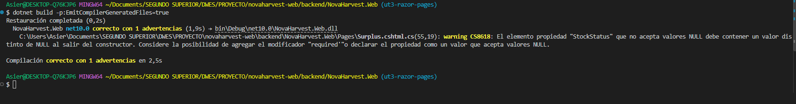
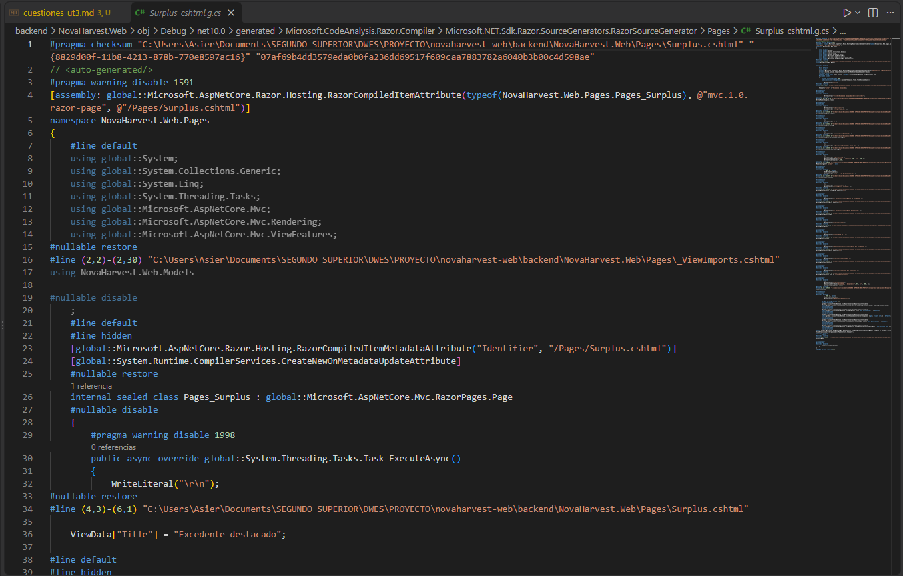
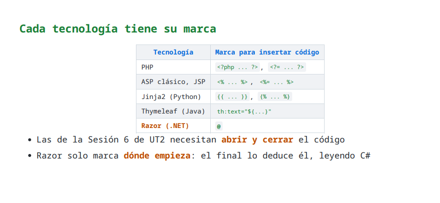
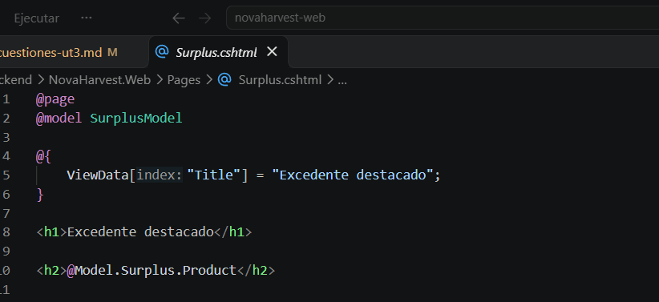
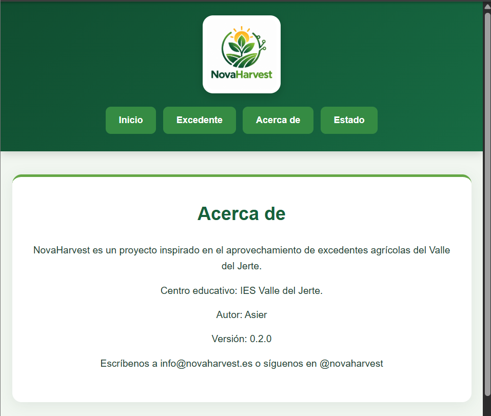
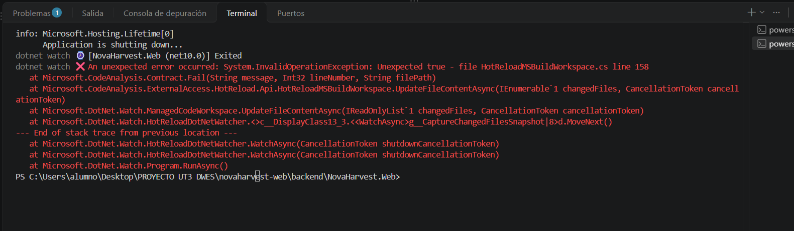
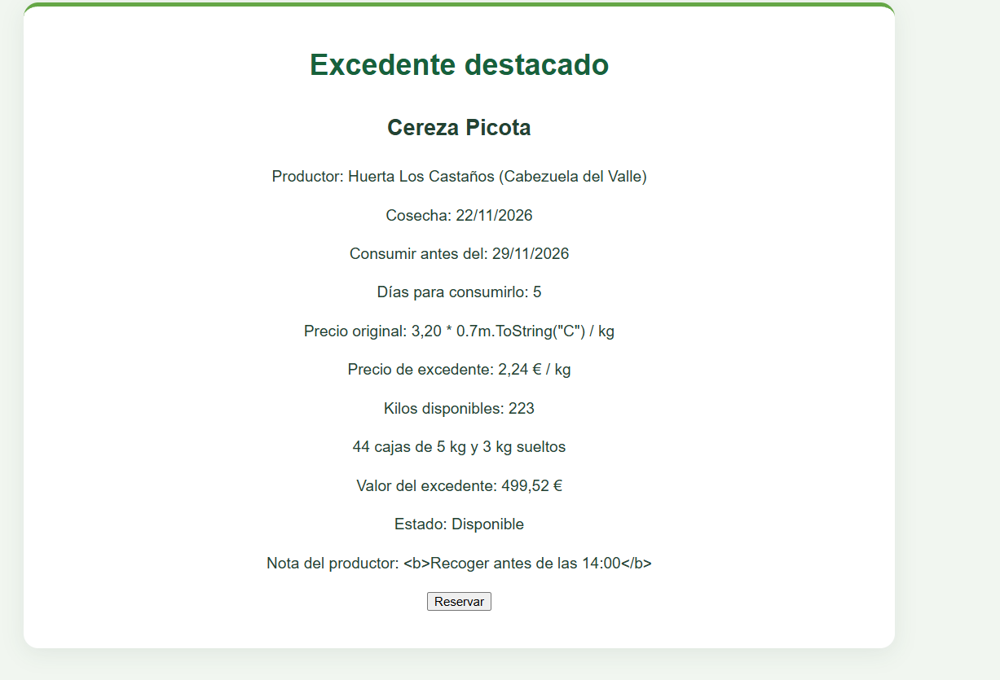

# Cuestiones UT3 - NovaHarvest

**Autor: Asier Martín Jiménez**

## 1. De .cshtml a HTML

Al ejecutar dotnet build -p:EmitCompilerGeneratedFiles=true, el proyecto se compila y genera el archivo NovaHarvest.Web.dll. También se genera la clase para las páginas Razor. En mi caso, he localizado la página; dentro de ella aparece información de la propia página, como, por ejemplo, el título: `ViewData["Title"] = "Excedente destacado";`.

Por lo que Razor combina los dos valores, tanto el HTML como los valores del PageModel, para generar la página según la entrada del navegador.

El WriteLiteral sale directamente de lo que se escribe en el archivo .cshtml.

El Write sale de las expresiones Razor que empiezan por @, como `@Model.ServerTime.ToString("dd/MM/yyyy HH:mm:ss")`, y muestra el valor obtenido de esa expresión.

No hay ningún archivo .cshtml porque las páginas Razor se compilan y se convierten en código C#, que es el que utiliza la aplicación para ejecutarse. Por eso, no incluye los archivos .cshtml.

 

 

 

 
 # 2. Tecnologías.

 Actualmente en mi pagina de Surplus.cshtml el precio lo muestro con esta linea:

`
Precio de excedente: @Model.SurplusPrice.ToString("C") / kg
`

En php se utiliza <?= ... ?> para mostrar el resultado de la expresion.

En Asp clásico se utiliza <%= ... %>.

En Razor se utiliza @ para comenzar el codigo, una diferencia con las otras es que estas utilizan apertura y cierre <?= ... ?> pero con Razor únicamente @ al comienzo y este reconoce automaticamente dónde termina por lo que no necesita de cierre.

Al cambiar de MapGet a razor hemos dejado de escribir el HTML en Strings, lo que hacia que el HTML estaba mezclado con el C#. Ahora al utilizar Razor Pages cada pagina tiene su propio .cshtml donde se escribe directamente HTML y añado C# donde sea necesario mediante @ Además, ya no tengo que registrar cada página manualmente porque la URL sale de la ubicación del archivo.

Antiguo Program.cs

Nuevo Program.cs

# 3. Etiquetas de código. 

En mi proyecto uso varias formas de introducir codigo C# dentro del HTML gracias a Razor

**Expresión implícita**

En Surplus.cshtml utilizo:

`<h2>@Model.Surplus.Product</h2>`

En el Navegador aparece:

**Expresión explícita**

`
Nota del productor: @(Model.Surplus.Note ?? "Sin observaciones")
`

Y el HTML al ver el código fuente es:

Utilizo los paréntesis porque es una expresión explícita y dentro de ellos puedo utilizar operadores.

**Bloque de código @{ }**

En Surplus.cshtml utilizo:

Este bloque se utiliza para guardar el título de la página, recoge el layout compartido y lo utiliza en la etiqueta tittle

**Carácter @@**

En About.cshtml utilizo:

`
Escríbenos a info@novaharvest.es o síguenos en @@novaharvest
`

En el navegador aparece:

**Comentario Razor @* *@**

En Surplus.cshtml tengo este comentario:

@* Datos del productor y del producto. *@

Este comentario no aparece en el HTML que recibe el navegador.

**¿Por qué info@novaharvest.es no necesita @@ y @novaharvest sí?**

En el correo electrónico hay letras justo delante del arroba, por lo que Razor no lo interpreta como el comienzo de código. En cambio, en @novaharvest el arroba aparece al principio y Razor intenta interpretarla como una expresión de C#. Por eso utilizo @@ para mostrarla como un carácter normal.

# 4. Sintexis

**Cambiar SurplusPrice por SurplusPrize**

El problema ocurre en que en mi Surplus.cshtml.cs la propiedad se llama SurplusPrice, por lo que al intentar buscar "SurplusPrize" da error de compilación ya que no encuentra el nombre de la variable

**Añadir @Model.Surplus.PricePerKg * 0.7m**

Como esta explicado en el bloque 2 diapositiva 8, no da error ya que Razor separa los contenidos en 2 partes

1. @Model.Surplus.PricePerKg - es decir lo que va detras del @, esto se interpreta como codigo C#

2. *0.7m - Lo interpreta como texto normal, porque encuentra un espacio y termina la expresión implícita.

**Solución**

Para que la operación funcione hay que excribirla de maneria explícita:

@(Model.Surplus.PricePerKg * 0.7m)